# MRI 뇌종양 → 소견서 Top-k 검색 (CLIP fine-tuning)

claude --resume 1ffca38f-8e76-422d-b27f-1889baad4bbc


뇌종양 MRI 케이스(T1/T2/FLAIR/T1C)를 입력하면, 소견서 bank에서 가장 비슷한 소견서 top-k를 찾아 주는 CLIP 모델의 학습/검색 스크립트입니다.

- 스크립트: `clip_mri_report.py` (`train`, `retrieve` 두 명령)
- 서버 학습: `run_train.sh` (Dgist-61 서버, `~/Workspace/rrg-clip`, 아래 **서버 학습** 참고)
- 실행 환경
  - 서버: conda env `~/.conda/envs/rrg-clip` (torch 2.14.1+cu130, torchvision 0.29.1, transformers 4.57.6, tensorboard 2.21)
  - 로컬: conda env `rrg-cheXpert`

## 저장소와 다른 PC에서 이어서 작업하기
- GitHub: `Cape-penguin/RRG` (private)
- git에 **포함하지 않는 것** (`.gitignore`)
  - `data/`: 원본 데이터셋(병원 소견서). NAS `/media/NAS66/huiseung/severance/`에 있습니다.
  - `*.pt`, `runs/*/checkpoints/`: 모델 가중치. best.pt가 626MB라 git에 올릴 수 없습니다. 서버 `~/Workspace/rrg-clip/runs/`에 있습니다.
- git에 **포함하는 것**: 코드, 노트북, README, `runs/`의 로그·TensorBoard·그림·CSV·지표, Claude Code 대화 기록(`claude/`)

### Claude Code 대화 기록 동기화 (`claude_sync.sh`)
Claude Code는 대화를 `~/.claude/projects/<프로젝트 경로>/<session-id>.jsonl`에 저장합니다. 이 파일을 `claude/sessions/`에 복사해 git으로 옮깁니다. 백업할 세션 목록은 `claude/SESSIONS`에 있습니다.

```bash
# 이 PC에서 작업한 뒤 올릴 때
bash claude_sync.sh export        # ~/.claude → claude/
git add -A && git commit -m "..." && git push

# 다른 PC에서 처음 받을 때
git clone git@github.com:Cape-penguin/RRG.git rrg && cd rrg
bash claude_sync.sh import        # claude/ → ~/.claude/projects/<이 PC의 저장소 경로>/
claude --resume 1ffca38f-8e76-422d-b27f-1889baad4bbc

# 이후 동기화
git pull && bash claude_sync.sh import
```
- import는 저장소를 clone한 경로에 맞춰 폴더 이름을 정하므로, 다른 경로에 clone해도 됩니다.
- 로컬에 더 긴(더 최근) 대화 기록이 있으면 덮어쓰지 않습니다.
- 두 PC에서 같은 세션을 동시에 이어 쓰면 한쪽 내용이 사라질 수 있습니다. 한 PC에서 작업을 끝내고 export → push한 뒤 다른 PC에서 pull → import하세요.
- 속도: 서버 A6000에서 batch 32 기준 epoch당 약 22초 (로컬 RTX 5070, batch 16 기준 약 18초)

## 데이터

| 항목 | 경로 / 내용 |
|---|---|
| **Train** (현재 사용) | `/media/NAS66/huiseung/severance/medcap/findings_20250624_rewrite_hardmut_split_train.json` |
| **Test** (현재 사용) | `/media/NAS66/huiseung/severance/medcap/findings_20250624_rewrite_hardmut_split_test.json` |
| (이전) 전체 1건씩 | `/media/NAS66/huiseung/severance/medcap/findings_20250624_rewrite_split_all.json`: IDH 문장이 없는 버전. `--train_json '' --json ...`으로 사용 |
| 이미지 | `/media/NAS66/huiseung/severance/1005_anony_png/<case_id>/{T1,T2,FLAIR,T1C}/<case_id>_0001.png ...` |

- 위 경로는 서버 경로이며, 스크립트 기본값도 이 경로입니다.
- 로컬 PC에서는 같은 데이터가 `/home/user/src/nas66/huiseung/severance/...`에 있습니다. 로컬에서 돌릴 때는 `--train_json`, `--test_json`, `--image_root`를 직접 지정해야 합니다.

### hardmut 데이터 특징 (현재 사용)

- **소견서 끝에 IDH 변이 상태 문장이 붙어 있습니다**("End of radiology report." 대신). 종류는 2가지입니다.
  - `... indicates IDH-wildtype glioblastoma.`
  - `... indicates oligodendroglioma (IDH-mutant and 1p/19q codeleted) or IDH-mutant astrocytoma.`
- **소견서 길이:** CLIP 토큰 기준 중앙값 90, 95%가 140, 최대 214입니다. IDH 문장이 맨 끝에 있어서 잘리지 않도록 `--max_text_len` 기본값을 **224**로 늘렸습니다.
- **Train:** 1340개 항목이 901개 케이스에 대응합니다.
  - 라벨 0/1 케이스가 2~3번 반복돼 있어서 항목 기준 라벨 비율이 2:670 / 0:335 / 1:335입니다(오버샘플링, 같은 케이스는 같은 소견서).
  - 이 오버샘플링은 그대로 학습에 씁니다.
  - 같은 케이스가 한 batch에 두 번 들어가면 서로를 오답으로 학습하게 됩니다. 이를 막기 위해 같은 case id끼리는 positive로 취급하는 multi-positive InfoNCE를 씁니다.
- **Test:** 100건이며 train과 겹치는 케이스가 없습니다. 라벨은 2:72 / 0:14 / 1:14입니다.
- **Val:** train 901개 케이스 중 라벨 비율을 유지하며 10%(90 케이스, seed 42)를 떼어 냅니다. 이 케이스들의 중복 항목은 모두 train에서 빠집니다.
- **최종 분할:** train 811 케이스(학습 항목 1206개) / val 90 / test 100

JSON 항목 예시:
```json
{"image": "AA0003",
 "meta": "dir=...;subdir=T1,T2,FLAIR,T1C;num=30;label=0;example=AA0003_0001.png",
 "conversations": [{"from": "human", "value": "Age: 38\nSex: male\n\n①①①..."},
                   {"from": "gpt",   "value": "A patient has a T2 high infiltrative glioma ... End of radiology report."}]}
```

### 데이터에서 확인한 점
- 1001건이고 case id와 소견서가 모두 서로 다릅니다.
- 라벨(`meta`의 `label=`) 분포는 0: 134건, 1: 147건, 2: 720건입니다.
- 케이스마다 4개 모달리티 폴더가 있고, 각 폴더에 같은 개수의 axial 슬라이스가 있습니다. 케이스당 **9~58장**이고 평균 31.9장, 중앙값 32장입니다. 12장 미만인 케이스는 9건입니다. 슬라이스는 224×224 PNG이며, 회색조 영상을 RGB로 저장한 형태입니다.
- **데이터 분할 (이전 `_split_all.json` 사용 시)**
  - `_split_all.json` 자체에는 train/val/test 구분이 없습니다. 대신 서버에 공식 `_split_test.json`(100건)이 있어서 이것을 test로 씁니다(`--test_json`, 기본값).
  - 나머지 901건에서 라벨 비율을 유지하며 10%(seed 42)를 val로 뗍니다. 결과는 train 811 / val 90 / test 100입니다.
  - 분할 결과는 `<output_dir>/split.json`으로 저장됩니다.
  - 서버에는 `_split_train.json`도 있습니다. 1340개 항목이 901개 케이스에 대응하며, 일부 케이스(164건은 3번, 111건은 2번)가 같은 소견서로 중복돼 있습니다(오버샘플링으로 보입니다). 여기서는 중복 없이 케이스당 1번씩만 씁니다.
  - `--test_json ''`로 주면 예전처럼 80/10/10으로 무작위 분할합니다.
- **소견서 길이:** CLIP 토큰 기준으로 중앙값 58, 95%가 116, 최대 185입니다. 약 25%가 CLIP 기본 길이 제한인 77 토큰을 넘습니다.
- **깨진 PNG가 2장 있습니다**(전체 127,636장 중):
  - `AA0979/T2/AA0979_0030.png`
  - `AA0941/T1C/AA0941_0006.png`

  이 슬라이스는 같은 모달리티의 가장 가까운 정상 슬라이스로 대신 읽습니다.

### 텍스트 전처리
- gpt 쪽 소견서만 씁니다. 끝의 `End of radiology report.` 문구는 지우고, 공백을 정리합니다.
- human 쪽 대화(나이/성별 + ① 자리표시 문자)는 학습에 쓰지 않습니다. 파싱만 해서 record에 보관합니다.

## 모델 구조

```
케이스 → 슬라이스 S장 샘플링 → [S × M장의 224×224 이미지]
      → CLIP ViT-B/16 (슬라이스별 pooler_output, 768d)
      → + slice position emb + modality emb, [CLS] 추가
      → Transformer aggregator (2층, 8 head, pre-norm)
      → [CLS] → LayerNorm → CLIP visual_projection → 512d, L2 norm
소견서 → CLIP text encoder (position embedding 77→224 확장) → text_projection → 512d, L2 norm
손실: symmetric InfoNCE (CLIP loss, learnable temperature, 같은 case id는 multi-positive)
```

- **슬라이스 합치는 방식 (`--fusion`)**
  - `composite`(기본): 슬라이스마다 3개 모달리티를 RGB 채널로 합칩니다(기본 FLAIR, T1C, T2). 케이스당 S장(기본 12)을 인코딩합니다.
  - `separate`: 모달리티마다 따로 인코딩하고(회색조→3채널), modality embedding으로 구분합니다. 케이스당 S×M장이 됩니다. T1까지 4개를 모두 쓸 때 사용합니다.
- **슬라이스 샘플링:** 볼륨을 S구간으로 나눠 구간마다 1장을 뽑습니다(TSN 방식). 학습 때는 구간 안에서 무작위로, 평가 때는 구간 중앙을 뽑습니다.
- **긴 소견서 처리:** Long-CLIP 방식을 씁니다. 앞 20개 position embedding은 그대로 두고, 나머지를 선형 보간해 224까지 늘립니다(`--max_text_len`).
- **증강(학습 시에만)**
  - 한 케이스의 모든 슬라이스와 모달리티에 같은 기하 변환을 적용합니다(회전 ±10°, 이동 5%, 확대·축소 0.9–1.1).
  - 모달리티마다 밝기 gain/bias를 조절합니다.
  - **좌우 반전은 쓰지 않습니다.** 소견서에 좌/우 위치(left/right)가 나오기 때문입니다.
- **학습 범위:** 데이터가 약 800건으로 적어서 CLIP의 vision과 text 모두 마지막 4개 블록만 학습합니다. 그 외에 projection, final norm, 텍스트 position embedding, logit_scale과 aggregator를 학습합니다.

### 입력 처리 상세 (기본 설정: `--num_slices 12 --fusion composite --modalities FLAIR T1C T2`)

**1) 슬라이스 선택: 케이스당 12장만 사용**
- 볼륨(9~58장, 중앙값 32장)을 12구간으로 똑같이 나누고, 구간마다 1장씩 뽑습니다(`sample_slice_indices`). 그래서 볼륨의 위쪽부터 아래쪽까지 고르게 덮습니다.
  - 학습할 때는 구간 안에서 무작위로 뽑습니다. epoch마다 다른 슬라이스를 보게 되므로 증강 효과가 있습니다.
  - 평가와 검색할 때는 구간 중앙 슬라이스로 고정합니다(결과가 항상 같습니다).
- 12장보다 적은 케이스는 일부 슬라이스를 반복해서 씁니다.

| 슬라이스 수 | 평가 시 인덱스 | 학습 시 예시 (무작위) |
|---|---|---|
| 9장 | 0,0,1,2,3,3,4,5,6,6,7,8 | 0,1,1,2,3,4,5,5,6,6,7,8 |
| 32장 | 1,3,6,9,11,14,17,19,22,25,27,30 | 0,2,7,9,11,14,16,18,23,25,29,31 |
| 58장 | 2,6,11,16,21,26,31,35,40,45,50,55 | 0,6,12,16,23,25,33,36,41,47,50,53 |

**2) 모달리티 합치기**
- `composite`: 같은 번호의 FLAIR / T1C / T2 슬라이스를 R / G / B 채널로 쌓아 이미지 1장으로 만듭니다. **T1은 쓰지 않습니다.**
- `separate`: 모달리티마다 흑백 영상을 3채널로 복사해 따로 인코딩합니다.

**3) 전처리**
- PNG를 흑백(L)으로 읽어 0~1로 스케일하고, 224×224로 맞춥니다(원본도 224×224).
- CLIP 평균·표준편차로 정규화합니다. 정규화 후 값은 대략 -1.8~2.2입니다.
- 학습할 때만 증강을 넣습니다.
  - 기하 변환(회전 ±10°, 이동 5%, 확대·축소 0.9~1.1)을 케이스의 모든 슬라이스·모달리티에 **똑같이** 적용합니다.
  - 모달리티마다 밝기를 조절합니다(gain 0.9~1.1, bias ±0.05).
  - 좌우 반전은 하지 않습니다.

**4) 인코딩과 집계**
- 슬라이스마다 ViT를 통과시킨 뒤 [CLS] 특징(768차원)을 뽑습니다.
- 여기에 슬라이스 위치 임베딩과 모달리티 임베딩을 더합니다.
- 맨 앞에 [CLS] 토큰을 붙여 Transformer 2층에 넣습니다.
- [CLS] 출력을 visual projection에 통과시켜 케이스 벡터(512차원)를 만듭니다.

**한계**
- 평가할 때는 평균 2.7장 간격으로 건너뛰므로, 작은 병변이 있는 슬라이스가 빠질 수 있습니다.
- 종양이 없는 맨 위·아래 슬라이스도 똑같이 1장씩 들어갑니다.
- 바꿔 볼 옵션: `--num_slices 24/32`, `--fusion separate --modalities T1 T2 FLAIR T1C`

### Tensor shape (batch 32, 학습 시 실측)

B = batch(32), S = 슬라이스 수(12), M = 모달리티 단위 수(composite이면 1, separate이면 4), L = batch 안에서 가장 긴 소견서의 토큰 수(최대 224, 아래 예시에서는 130)

| 단계 | shape | dtype / 비고 |
|---|---|---|
| **이미지 입력** `pixel_values` | **[B, S, M, 3, H, W] = [32, 12, 1, 3, 224, 224]** | float32, CLIP 정규화 (≈ -1.8 ~ 2.2) |
| ViT 입력 (B·S·M개를 펼침) | [384, 3, 224, 224] | bf16 autocast |
| ViT 토큰 출력 | [384, 197, 768] | 197 = 1 [CLS] + 14×14 패치 (16px) |
| 슬라이스 특징 (pooler) | [384, 768] → [32, 12, 1, 768] | + slice_pos [1, 12, 1, 768] + mod_emb [1, 1, 1, 768] |
| Aggregator 입력 / 출력 | [32, 13, 768] | 13 = [CLS] 1 + S·M 12 |
| **이미지 임베딩** | **[32, 512]** | [CLS] → LayerNorm → visual_projection → L2 정규화 |
| **텍스트 입력** `input_ids` | **[B, L] = [32, 130]** | int64, CLIP BPE 토큰 (SOT … EOT + padding) |
| `attention_mask` | [32, 130] | int64, 실제 토큰 1 / padding 0 (이 batch의 실제 길이 48~130) |
| 텍스트 hidden | [32, 130, 512] | CLIP text transformer (hidden 512), position embedding 224개 |
| 텍스트 pooled | [32, 512] | EOT 토큰 위치의 hidden |
| **텍스트 임베딩** | **[32, 512]** | text_projection → L2 정규화 |
| logits | [32, 32] | logit_scale(≈100) × cosine 유사도, 대각선이 정답 (같은 case id는 multi-positive) |

- `--fusion separate`(4개 모달리티)이면 이미지 입력은 [B, S, 4, 3, 224, 224]가 됩니다.
  - ViT에는 B·S·4장이 들어가고, aggregator 길이는 1 + S·4가 됩니다.
- 텍스트는 batch마다 가장 긴 소견서 길이에 맞춰 padding합니다(동적 padding). 그래서 L은 batch마다 달라집니다.
- 검색(retrieve)할 때는 케이스 1개씩 넣으므로 이미지 입력이 [1, 12, 1, 3, 224, 224]입니다. 소견서 bank 임베딩은 [811, 512]입니다.

### 이미지 ↔ 텍스트 대응 방식

**"펼치기"는 배치 단위 평가가 아닙니다.**
- `[32, 12, 1, 3, 224, 224]`를 `[384, 3, 224, 224]`로 reshape하는 것은 GPU 계산을 한 번에 하기 위해서일 뿐입니다.
- ViT 안에서 384장은 **서로 섞이지 않고, 슬라이스 한 장씩 독립된 2D 이미지로** 처리됩니다.
- ViT는 BatchNorm 대신 샘플마다 따로 계산하는 LayerNorm을 씁니다. 그래서 1장씩 384번 넣어도 결과가 같습니다. 검색 때 케이스 1개만 넣어도 학습 때와 똑같이 동작합니다.

```
[32, 12, 1, 3, 224, 224]   케이스 32개 × 슬라이스 12장
        │  reshape
[384, 3, 224, 224]         2D 이미지 384장 (각자 독립)
        │  ViT: 각 이미지 안의 패치 197개끼리만 attention
[384, 768] → [32, 12, 768] 케이스별로 다시 묶음
        │  Aggregator: 같은 케이스의 슬라이스 12장끼리만 attention (3D 정보 통합)
[32, 512]  케이스 임베딩  ←──── 비교 ────→  [32, 512]  소견서 임베딩
        │  Contrastive loss: 여기서 처음으로 케이스끼리 비교
[32, 32] logits
```

| 단계 | 정보가 섞이는 범위 |
|---|---|
| ViT | 슬라이스 1장 안 (16×16 패치끼리) |
| Aggregator | 케이스 1개 안 (같은 환자의 슬라이스 12장끼리) |
| Text encoder | 소견서 1개 안 (토큰끼리, causal attention) |
| Contrastive loss | batch 전체 (다른 31개 케이스를 오답 후보로 사용) |

**텍스트는 케이스 단위로 대응합니다. 소견서 1개가 케이스 1개(슬라이스 12장 전체)에 대응합니다.**
- 소견서는 볼륨 전체를 설명하는 글입니다. 그래서 슬라이스별로 나누지 않고 **통째로** 토큰화합니다.
  - `[L]` 토큰 → text encoder → 문장 끝 토큰 위치의 벡터 → `[512]`
- 짝짓기는 **케이스 벡터 1개 ↔ 소견서 벡터 1개**로만 합니다.
  - 슬라이스 하나와 문장 하나를 직접 짝짓는 대응은 없습니다. 예를 들어 "7번 슬라이스 ↔ insula 문장" 같은 짝이 없습니다.
  - batch 안에서는 i번째 케이스와 i번째 소견서가 positive이고, 나머지 31개 소견서는 negative입니다.
  - 오버샘플링으로 같은 case id가 batch에 두 번 들어오면, 그 소견서들도 positive로 처리합니다.
- 소견서는 "이 12장 어딘가에 이런 소견이 있다"는 **약한 지도(weak supervision)**입니다.
  - 종양이 없는 슬라이스도 같은 소견서와 묶여 들어갑니다.
  - 어느 슬라이스가 중요한지는 aggregator가 attention으로 스스로 배워야 합니다(multiple-instance learning과 비슷한 구조).
- **이 구조의 한계**
  - 슬라이스 단위의 근거가 없습니다. 모델이 어느 슬라이스, 어느 위치를 보고 판단했는지 직접 알 수 없습니다.
  - 데이터가 811 케이스뿐이라, 이 약한 신호로 좌우처럼 세밀한 공간 정보까지 배우기는 어렵습니다. 좌우 일치율이 무작위 수준(48%)이었던 것과 관련 있을 수 있습니다.
  - 개선 방향: 좌우 반전과 left↔right 단어 교체를 함께 하는 증강, 슬라이스 attention 가중치 시각화, 문장 단위 대응(소견서를 문장으로 나눠 local alignment)

### 모델 크기 (기본 `openai/clip-vit-base-patch16`)

| 구성 | 파라미터 |
|---|---|
| CLIP vision (ViT-B/16) | 85.8M |
| CLIP text (position embedding 224 포함) | 63.2M |
| Aggregator + 임베딩 | 14.2M |
| projection 등 | 약 0.7M |
| **전체** | **약 163.9M** |
| **학습되는 파라미터** (기본 설정) | **약 55.9M** |

- 체크포인트 `best.pt`는 약 655MB입니다(fp32 state_dict 전체).
- `--fusion separate`도 파라미터 수는 거의 같습니다. 인코딩하는 이미지 수만 늘어납니다.
- `--unfreeze_vision_layers -1 --unfreeze_text_layers -1`로 주면 전체를 학습합니다(약 164M).

## 학습

### 서버 학습 (Dgist-61, RTX A6000 48GB)

```bash
ssh Dgist-61:Nvidia_RTX_A6000_48GB
cd ~/Workspace/rrg-clip
bash run_train.sh clip_hardmut          # runs/clip_hardmut 에 결과 저장 (nohup 백그라운드)
bash run_train.sh exp2 --num_slices 16  # 실험 이름 + 추가 옵션
```

- **GPU:** 1번만 사용합니다. `CUDA_DEVICE_ORDER=PCI_BUS_ID`와 `CUDA_VISIBLE_DEVICES=1`로 nvidia-smi 번호와 맞췄습니다.
- **VRAM 제한:** `--max_vram_gb 24`로 프로세스 메모리를 24GB로 제한합니다(`torch.cuda.set_per_process_memory_fraction`).
  - batch 32에서 PyTorch 최대 사용량은 13.2GB이고, nvidia-smi 기준 프로세스 사용량은 약 14.6GB입니다.
- **학습 설정:** `run_train.sh`는 batch 32, 30 epoch, worker 12로 돌립니다.
- **이어서 학습:** 서버가 중단되면 **같은 명령을 다시 실행**하면 됩니다. `runs/<run>/checkpoints/`의 마지막 epoch 체크포인트에서 이어서 학습합니다.
  - 체크포인트에는 model, optimizer, step, best 기록, RNG 상태가 함께 저장됩니다.
  - 처음부터 다시 하려면 `--no_resume`을 주거나 run 이름을 바꾸면 됩니다.

진행 상황 확인:
```bash
tail -f ~/Workspace/rrg-clip/runs/clip_hardmut/train.log      # epoch별 요약 로그
tail -f ~/Workspace/rrg-clip/runs/clip_hardmut/stdout.log     # tqdm 진행바 포함 전체 출력
ps aux | grep clip_mri_report                             # 실행 중인지 확인

# TensorBoard (서버에서 실행 후 로컬로 포트 포워딩)
~/.conda/envs/rrg-clip/bin/tensorboard --logdir ~/Workspace/rrg-clip/runs --port 6006
# 로컬 PC에서:
ssh -N -L 6006:localhost:6006 Dgist-61:Nvidia_RTX_A6000_48GB   # 브라우저에서 http://localhost:6006
```

TensorBoard 기록 항목:

| 구분 | 항목 |
|---|---|
| step 단위 | `train/loss`, `train/grad_norm`, `train/logit_scale`, `lr/backbone`, `lr/new` (`--log_every` 간격, 기본 10 step) |
| epoch 단위 | `epoch/train_loss`, `epoch/time_sec`, `epoch/peak_vram_gb`, `val/*` (R@k, MedR, MRR, mean_R@5, bank_label_P@5) |
| 학습 종료 후 | `test/*` (best val 체크포인트 기준) |

### 발표용 그래프 (PNG)

TensorBoard 기록을 PNG로 저장합니다.
```bash
~/.conda/envs/rrg-clip/bin/python plot_tb.py runs/clip_hardmut          # 기본 200 dpi
~/.conda/envs/rrg-clip/bin/python plot_tb.py runs/clip_hardmut --dpi 300
```
- 결과는 `runs/<run>/figures/`에 저장됩니다(로컬 사본: `/home/user/src/rrg/runs/clip_hardmut/figures/`).
- 서버 env에서 실행합니다. 필요한 패키지는 tensorboard와 matplotlib입니다.

| 파일 | 내용 |
|---|---|
| `01_train_loss.png` | step별 loss(원본은 흐리게, EMA 평활선은 진하게) + epoch 평균 loss |
| `02_val_recall5.png` | val R@5 (image→text, text→image, 평균) + random 기준선 + best epoch |
| `03_val_i2t_recallK.png` | val image→text R@1 / R@5 / R@10 |
| `04_val_medr.png` | val median rank (낮을수록 좋음) + random 기준선 |
| `05_val_mrr.png` | val MRR |
| `06_loss_vs_val.png` | train loss와 val mean R@5를 위아래로 비교 (과적합 확인용) |
| `07_lr.png` | 학습률 스케줄 (backbone / 새 모듈) |
| `08_test_recall.png` | test R@1/5/10 막대그래프 + random 기준선 |
| `09_test_table.png` | test 지표 표 (R@K, MedR, MRR, label P@5, random 기준값) |
| `all/<tag>.png` | TensorBoard scalar tag마다 1장 (train/*, lr/*, epoch/*, val/* 20장) |

### 로컬 학습

```bash
conda activate rrg-cheXpert
cd /home/user/src/rrg
D=/home/user/src/nas66/huiseung/severance
python clip_mri_report.py train --output_dir runs/clip_hardmut --epochs 30 \
  --train_json $D/medcap/findings_20250624_rewrite_hardmut_split_train.json \
  --test_json $D/medcap/findings_20250624_rewrite_hardmut_split_test.json --image_root $D/1005_anony_png
```

주요 옵션 (기본값):

| 옵션 | 기본값 | 설명 |
|---|---|---|
| `--clip_model` | `openai/clip-vit-base-patch16` | HF CLIP 체크포인트 |
| `--modalities` | `FLAIR T1C T2` | composite이면 정확히 3개 |
| `--fusion` | `composite` | `composite` / `separate` |
| `--num_slices` | 12 | 케이스당 샘플링할 슬라이스 수 |
| `--max_text_len` | 224 | 텍스트 최대 토큰 수 |
| `--agg_layers` | 2 | aggregator Transformer 층 수 |
| `--unfreeze_vision_layers` / `--unfreeze_text_layers` | 4 / 4 | 학습할 마지막 블록 수, -1이면 전체 |
| `--epochs` | 30 | |
| `--batch_size` | 16 | contrastive batch 크기 |
| `--grad_accum` | 1 | |
| `--lr` / `--lr_new` | 1e-5 / 1e-4 | CLIP backbone / 새로 추가한 모듈 |
| `--weight_decay` / `--warmup_ratio` | 0.05 / 0.05 | AdamW, cosine schedule |
| `--split_file` | 없음 | 기존 `split.json` 재사용 |
| `--train_json` / `--test_json` | hardmut train / test json | `--train_json ''`이면 `--json` 하나로 분할 |
| `--val_ratio` | 0.1 | train 케이스 중 val 비율 |
| `--max_vram_gb` | 0 (제한 없음) | 프로세스 GPU 메모리 상한 (서버 스크립트는 24) |
| `--keep_last` | 5 | 최근 epoch 체크포인트를 몇 개까지 남길지 |
| `--log_every` | 10 | TensorBoard step 로그 간격 |
| `--no_resume` | (resume 켜짐) | 기존 체크포인트에서 이어서 하지 않음 |
| `--grad_ckpt` | off | 메모리가 부족할 때 사용 |

학습 과정:
- 매 epoch val에서 평가하고, `mean_R@5`(i2t와 t2i R@5의 평균)가 가장 높을 때 `best.pt`를 저장합니다.
- 학습이 끝나면 best 체크포인트로 test를 평가합니다.

출력 파일 (`--output_dir` 안):

| 파일 | 내용 |
|---|---|
| `train.log` | epoch별 요약 로그. train loss, val 지표, lr, epoch 시간, 최대 VRAM, 현재 best |
| `stdout.log` | 서버 실행 시 전체 콘솔 출력 (tqdm 포함) |
| `tb/` | TensorBoard 이벤트 파일 |
| `checkpoints/epoch_XXX.pt` | **최근 5개 epoch**의 이어서 학습용 체크포인트 (model + optimizer + 상태, 개당 약 1.1GB) |
| `best.pt` | **val mean_R@5가 가장 높았던** 모델 (따로 보관하며, 오래된 epoch 체크포인트를 지울 때도 지워지지 않음) |
| `args.json` / `split.json` | 학습 설정 / case id 분할 |
| `log.json` | epoch별 지표 (json) |
| `test_metrics.json` | 최종 test 지표 |
| `bank_*.pt` | retrieve 시 만들어지는 소견서 임베딩 캐시 |

- 체크포인트는 임시 파일에 먼저 쓴 뒤 이름을 바꾸는 방식(`.tmp` → rename)으로 저장합니다. 저장 도중 서버가 꺼져도 기존 파일이 깨지지 않습니다.

## 평가 지표

지표는 두 가지 상황으로 나눠서 봅니다.

### A. 같은 split 안에서 짝 맞히기 (`i2t_*`, `t2i_*`)
val(90건)이나 test(100건) 케이스의 이미지와 소견서를 서로 섞어 놓고, 각 이미지의 **진짜 짝 소견서**가 몇 등으로 나오는지 봅니다.
- **i2t**(image→text): MRI를 query로 넣고 소견서 N개를 유사도 순으로 정렬합니다. 우리가 실제로 쓰려는 방향입니다.
- **t2i**(text→image): 소견서를 query로 넣고 MRI N개를 정렬합니다. 반대 방향 검색입니다.

| 지표 | 뜻 | 좋은 방향 | test 100건 무작위 기준값 |
|---|---|---|---|
| **R@K** (Recall@K) | 정답 짝이 상위 K개 안에 들어온 query의 비율(%) | ↑ | R@1 1%, R@5 5%, R@10 10% |
| **MedR** (Median Rank) | 정답 짝 순위의 중앙값. 1이면 대부분 1등 | ↓ | 50.5 |
| **MRR** (Mean Reciprocal Rank) | 정답 순위 역수(1/rank)의 평균. 1등은 1점, 2등 0.5점, 10등 0.1점. 상위 순위에 가중치가 큼 | ↑ (최대 1) | 약 0.05 |
| **mean_R@5** | (i2t_R@5 + t2i_R@5) / 2. **best 모델 선택 기준** | ↑ | 5% |

#### 예시로 보는 계산법
query(MRI) 5개를 넣었더니 정답 소견서가 각각 **1등, 3등, 8등, 2등, 20등**에 나왔다고 해 봅니다.

| 지표 | 계산 | 값 |
|---|---|---|
| R@1 | 1등 안에 든 query: 1개 / 5 | 20% |
| R@5 | 5등 안에 든 query(1, 3, 2등): 3개 / 5 | 60% |
| R@10 | 10등 안에 든 query(1, 3, 8, 2등): 4개 / 5 | 80% |
| MedR | 순위 1, 2, 3, 8, 20의 중앙값 | 3 |
| MRR | (1/1 + 1/3 + 1/8 + 1/2 + 1/20) / 5 | 0.40 |

- **R@K**는 "의사가 top-K개를 훑어볼 때 정답 소견서가 그 안에 있을 확률"입니다. top-5를 보여 주는 서비스라면 R@5가 핵심 지표입니다.
- **MedR**은 "보통 몇 등에서 정답이 나오나"입니다. 20등처럼 아주 나쁜 query가 하나 있어도 크게 흔들리지 않습니다.
- **MRR**은 1등을 크게 쳐 주는 지표입니다. 위 예시처럼 1등이 한 번만 나와도 값이 많이 오릅니다. 1등을 얼마나 자주 맞히는지 비교할 때 좋습니다.
- **i2t와 t2i**는 같은 유사도 행렬을 가로로 읽느냐 세로로 읽느냐의 차이입니다. 그래서 대체로 비슷한 값이 나옵니다.

- 이 지표는 **똑같은 그 소견서**를 찾아야만 정답으로 칩니다.
- 내용이 거의 같은 다른 환자의 소견서(예: 비슷한 GBM 소견)가 1등으로 오면 틀린 것으로 셉니다. 그래서 의미상 성능보다 낮게 나오는 엄격한 지표입니다.

### B. train 소견서 bank에서 top-k 검색 (실제 사용 상황)
test MRI를 query로 넣고, **train 소견서 811개** 중 비슷한 top-k를 뽑습니다. 정답 소견서는 bank에 없으므로, 뽑힌 소견서가 **임상적으로 같은 종류인지**를 봅니다.

| 지표 | 뜻 | 기준값 |
|---|---|---|
| **bank_label_P@5** | top-5 소견서 중 라벨이 query 라벨과 같은 비율 | 무작위로 뽑으면 55.7%. bank의 72%가 라벨 2라서 기준값이 높습니다 |
| **IDH P@5** (`analyze_results.py`) | top-5 소견서의 IDH 문장(wildtype/mutant)이 정답과 같은 비율 | 무작위로 뽑으면 59.6% |
| **top-1 IDH/라벨 일치** (`analyze_results.py`) | 1등 소견서의 IDH/라벨이 정답과 같은 비율 | 무조건 wildtype만 골라도 IDH는 72% |
| **좌우 일치율** (`analyze_results.py`) | 정답 소견서가 left 또는 right 한쪽만 언급할 때, 뽑힌 소견서도 같은 쪽인지 | 약 50% |

### 라벨 정의 (데이터에서 확인)
- 라벨 2는 소견서의 IDH 문장이 전부 **IDH-wildtype glioblastoma**입니다.
- 라벨 0과 1은 전부 **IDH-mutant**(oligodendroglioma 또는 astrocytoma)입니다. 0과 1이 정확히 무엇을 구분하는지(예: 1p/19q codeletion 여부)는 메타데이터에 없어서 확인하지 못했습니다.

## 검색 (Top-k)

```bash
# 데이터셋 안의 특정 케이스 (여러 개 가능)
python clip_mri_report.py retrieve --ckpt runs/clip_hardmut/best.pt --case AA0003 --topk 5

# 새 MRI 폴더 (T1/T2/FLAIR/T1C 하위 폴더에 PNG 슬라이스가 있는 구조)
python clip_mri_report.py retrieve --ckpt runs/clip_hardmut/best.pt --case_dir /path/to/case --topk 5

# test split 전체 결과를 JSON으로 저장
python clip_mri_report.py retrieve --ckpt runs/clip_hardmut/best.pt --split test --topk 5 --out test_top5.json
```

- **`--bank train`(기본):** train split 소견서에서 찾습니다. val/test 케이스를 query로 쓸 때 정답 소견서가 섞이지 않습니다.
- **`--bank all`:** 전체 1001건에서 찾습니다. 이때 query 자기 자신의 소견서는 결과에서 빠집니다.
- 결과 JSON에는 케이스마다 `query`, `gt_report`, 그리고 `topk`(rank, id, score, label, report) 목록이 들어갑니다.

## 시험 실행 결과 (로컬, 2 epoch, 동작 확인용, 무작위 80/10/10 split)

| split | i2t R@1 | i2t R@5 | i2t R@10 | t2i R@5 | bank_label_P@5 |
|---|---|---|---|---|---|
| val (epoch 1) | 3.0 | 14.0 | 26.0 | 22.0 | 68.8 |
| test (best val) | 7.0 | 21.0 | 33.0 | 20.0 | 69.4 |

- 2 epoch만 돌린 결과라 성능 판단용이 아닙니다. 30 epoch 전체 학습은 아직 돌려 보지 않았습니다.
- 이 단계에서는 검색 점수(cosine)가 0 근처라 순위 사이 차이가 작았습니다. 정식 학습 후 다시 확인해야 합니다.

## 학습 결과: `clip_hardmut` (서버, 30 epoch, hardmut 데이터)

- **설정:** ViT-B/16, composite(FLAIR·T1C·T2), 슬라이스 12장, batch 32, lr 1e-5/1e-4, 30 epoch, 2026-10-15 학습
- **best 모델:** 18번째 epoch(0부터 세면 17)이고, val mean_R@5는 56.1입니다. 마지막 epoch의 val mean_R@5는 52.8입니다.
- 아래 숫자는 `analyze_results.py runs/clip_hardmut`로 다시 만들 수 있습니다. 전체 top-5 결과는 `runs/clip_hardmut/test_top5.json`에 있습니다.

### Test 지표 (100건)

| 방향 | R@1 | R@5 | R@10 | MedR | MRR |
|---|---|---|---|---|---|
| i2t (MRI→소견서) | 15.0 | **47.0** | 70.0 | 6 | 0.298 |
| t2i (소견서→MRI) | 21.0 | **51.0** | 66.0 | 5 | 0.342 |
| 무작위 기준값 | 1.0 | 5.0 | 10.0 | 50.5 | ~0.05 |

- i2t 정답 순위 분포(누적): 1등 15건, 5등 이내 47건, 10등 이내 70건, 20등 이내 82건, 50등 이내 97건입니다. 가장 나쁜 경우는 81등입니다.

### 그룹별 (i2t, test 100건 안에서)

| 그룹 | n | R@1 | R@5 | R@10 | MedR |
|---|---|---|---|---|---|
| 라벨 0 (IDH-mutant) | 14 | 21.4 | 57.1 | 78.6 | 4 |
| 라벨 1 (IDH-mutant) | 14 | 14.3 | 71.4 | 78.6 | 4 |
| 라벨 2 (IDH-wildtype GBM) | 72 | 13.9 | 40.3 | 66.7 | 7 |

- **GBM(라벨 2) 케이스가 오히려 짝 맞히기가 어렵습니다.** GBM 소견서는 "조영증강, 괴사, 부종"처럼 서로 비슷한 경우가 많습니다. 그래서 비슷한 다른 환자 소견서가 정답보다 위에 오기 쉽습니다.

### train bank 검색 (test MRI → train 소견서 811개)

| 지표 | 결과 | 무작위 기준값 |
|---|---|---|
| top-1 IDH 일치 | **84%** | 72% (무조건 wildtype만 골랐을 때) |
| IDH P@5 | **82.4%** | 59.6% |
| top-1 라벨 일치 | 79% | – |
| bank_label_P@5 | 77.6% | 55.7% |
| ├ 라벨 0 query | 31.4% | 13.3% (bank 중 라벨 0 비율) |
| ├ 라벨 1 query | 40.0% | 14.8% |
| └ 라벨 2 query | 93.9% | 71.9% |
| 좌우 일치 (top-1 / top-5) | **48.0% / 46.7%** | 약 50% |

IDH 혼동표 (정답 → top-1 소견서):

| | top-1 wildtype | top-1 mutant |
|---|---|---|
| 정답 wildtype (72) | 68 | 4 |
| 정답 mutant (28) | **12** | 16 |

### 해석
1. **검색은 잘 학습됐습니다.** test R@5 47~51%는 무작위(5%)의 약 10배입니다. 정답 순위 중앙값은 6등입니다.
2. **IDH 상태는 꽤 잘 맞힙니다.**
   - top-5 IDH 일치율이 82.4%로 무작위(59.6%)보다 확실히 높습니다.
   - 다만 **mutant 케이스의 43%(12/28)는 1등으로 wildtype 소견서를 가져옵니다.** 조영증강이나 괴사가 있는 mutant(예: anaplastic glioma)를 GBM으로 착각하는 경향입니다.
   - bank의 72%가 wildtype이라 이쪽으로 쏠리기 쉬운 구조이기도 합니다.
3. **라벨 0과 1의 구분은 약합니다.**
   - 라벨 0/1 query의 P@5는 31~40%로 무작위(13~15%)보다는 높습니다. 하지만 top-1 기준으로 0과 1끼리 서로 바뀌는 경우가 많습니다.
   - 0↔1 혼동이 4건이고, 0/1 query인데 2를 가져온 경우가 12건입니다.
4. **좌우(left/right)는 전혀 학습되지 않았습니다.** 좌우 일치율이 48%로 무작위 수준입니다. 부위(insula, 측두엽 등)와 조영증강 양상은 맞추지만, 반대쪽 병변의 소견서를 가져오는 일이 흔합니다.
5. **과적합이 있습니다.**
   - train loss는 3.6에서 0.02까지 내려갔습니다.
   - val mean_R@5는 epoch 12 무렵부터 45~56% 사이에서 정체했습니다. val이 90건이라 epoch마다 ±5%p 정도 흔들립니다.
   - 학습 시간의 절반 이상이 사실상 성능 향상 없이 쓰였습니다.
6. **유사도 점수는 상대적인 값입니다.**
   - bank 유사도 평균은 0.017(표준편차 0.079), top-1 평균은 0.232입니다.
   - 학습된 temperature가 100이라 작은 cosine 차이도 큰 확률 차이가 됩니다. 점수의 절대값보다 순위로 봐야 합니다.

### 그래프로 보는 결과

그래프 파일은 `runs/clip_hardmut/figures/`에 있습니다(`plot_tb.py`로 생성). epoch은 1부터 셉니다.

#### ① 학습 loss: `01_train_loss.png`
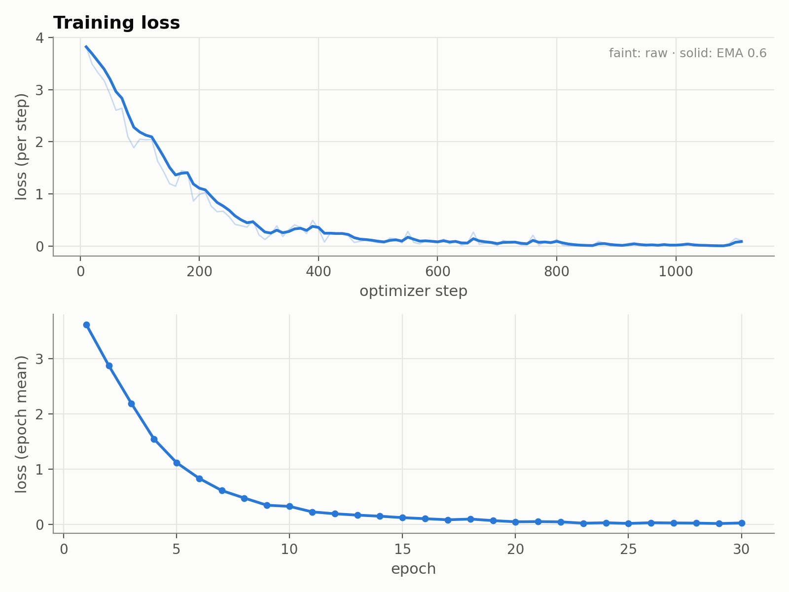
- **무엇:** contrastive loss입니다. batch 32개 중 정답 짝을 고르는 32지선다를 얼마나 잘 푸는지 나타냅니다.
  - 무작위면 ln(32) ≈ 3.47이고, 0이면 완벽하게 고른다는 뜻입니다.
- **결과:** 3.62(epoch 1) → 1.12(epoch 5) → 0.33(epoch 10) → 0.03(epoch 30).
  - epoch 10 이후로는 train 데이터의 짝을 거의 외운 상태입니다.

#### ② val Recall@5: `02_val_recall5.png`
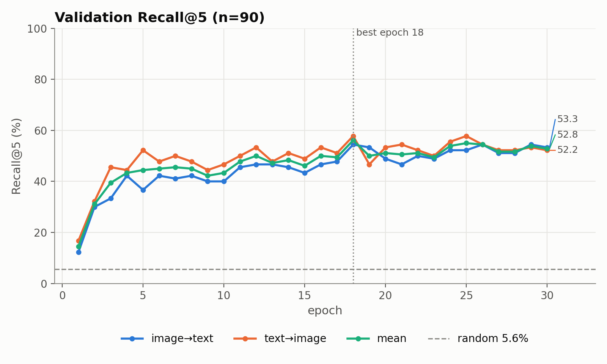
- **무엇:** 학습에 쓰지 않은 val 90건에서, 정답 짝이 top-5 안에 드는 비율입니다. 점선은 random 기준값(5.6%)입니다.
- **결과(mean R@5)**

  | epoch | 1 | 5 | 12 | **18 (best)** | 30 |
  |---|---|---|---|---|---|
  | mean R@5 | 14.4 | 44.4 | 50.0 | **56.1** | 52.8 |

  - 첫 5 epoch 동안 빠르게 오른 뒤, 이후로는 천천히 올라 epoch 18에서 최고점을 찍었습니다.
  - 이 시점의 모델을 `best.pt`로 저장했습니다.

#### ③ val image→text R@1 / R@5 / R@10: `03_val_i2t_recallK.png`
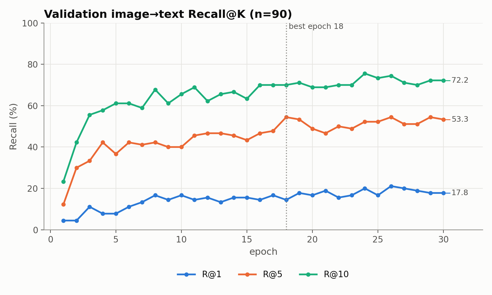
- **무엇:** MRI를 넣었을 때 정답 소견서가 1등 / 5등 / 10등 안에 드는 비율입니다.
- **결과(epoch 18):** R@1 14.4, R@5 54.4, R@10 70.0 (random은 1.1 / 5.6 / 11.1).
  - 정답이 1등으로 나오는 경우는 7번 중 1번 정도로 많지 않습니다.
  - 10등 안에는 70%가 들어옵니다. 즉 정답을 "비슷한 후보군" 안으로는 잘 데려오지만, 그 안에서 1등으로 고르는 건 어렵습니다.
  - GBM 소견서처럼 내용이 서로 비슷한 후보가 많기 때문입니다.

#### ④ val median rank: `04_val_medr.png`
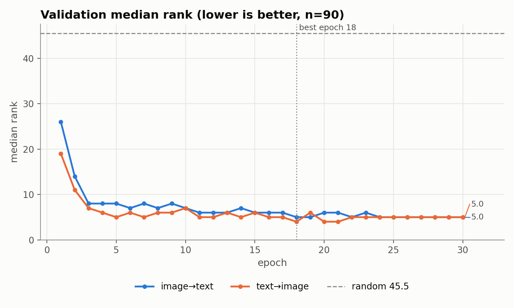
- **무엇:** 정답 짝 순위의 중앙값입니다. 낮을수록 좋고, random은 45.5입니다.
- **결과:** image→text 26등(epoch 1) → 5등(epoch 18), text→image 19등 → 4등.
  - 90개 후보 중 보통 5등 안팎에서 정답이 나옵니다.

#### ⑤ val MRR: `05_val_mrr.png`
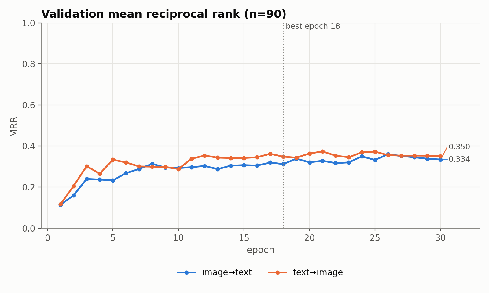
- **무엇:** 정답 순위 역수의 평균입니다. 높을수록 좋습니다.
- **결과:** 0.12(epoch 1) → 0.31~0.35(epoch 18 이후).
  - 0.33은 평균적으로 "3등 정도" 수준에 해당합니다.
  - epoch 12 이후로는 거의 변하지 않았습니다.

#### ⑥ train loss vs val 성능 (과적합 확인): `06_loss_vs_val.png`
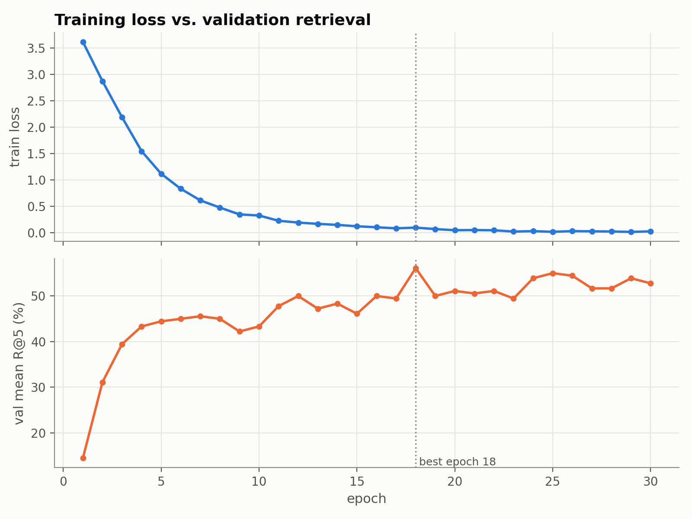
- **무엇:** 위는 train loss, 아래는 val mean R@5입니다. 같은 epoch 축으로 비교합니다.
- **결과:** epoch 12 이후 train loss는 0.19에서 0.03까지 계속 떨어집니다. 반면 val mean R@5는 50~56% 사이에서 오르내리기만 합니다.
  - **train만 더 잘 맞히고 val은 더 좋아지지 않는 과적합 구간**입니다.
  - val이 90건이라 1건이 약 1.1%p에 해당합니다. 그래서 ±3%p 정도의 흔들림은 우연일 수 있습니다.
  - epoch 18이 best로 뽑힌 것도 이 흔들림 덕일 수 있어서, 15~30 epoch 사이 모델들은 실제 성능이 비슷하다고 보는 게 맞습니다.

#### ⑦ 학습률: `07_lr.png`
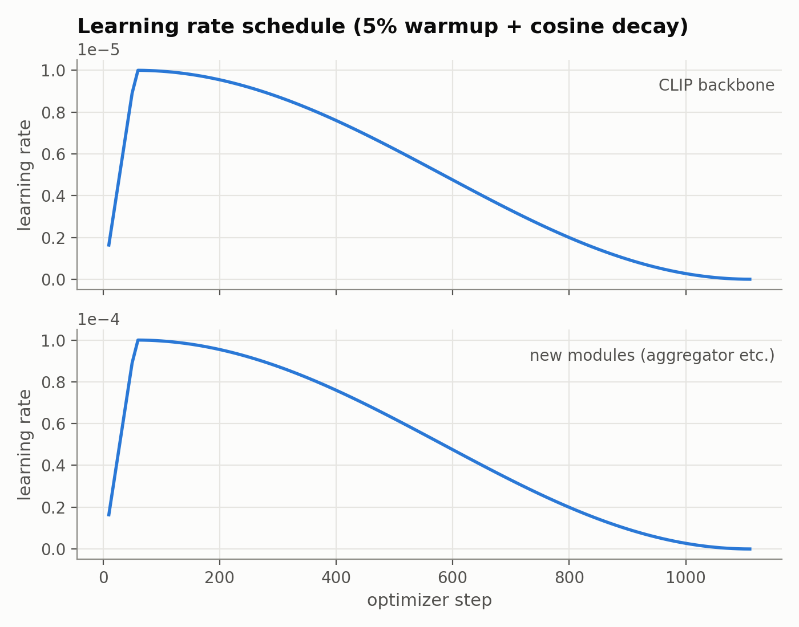
- **무엇:** 처음 5%(약 56 step) 동안 학습률을 0에서 올린 뒤(warmup), cosine 곡선으로 0까지 줄입니다.
  - CLIP backbone은 1e-5, 새로 추가한 aggregator 등은 10배인 1e-4입니다.
- **참고:** 학습률이 거의 0에 가까운 마지막 몇 epoch에는 모델이 거의 변하지 않습니다.

#### ⑧ ⑨ test 최종 결과: `08_test_recall.png`, `09_test_table.png`
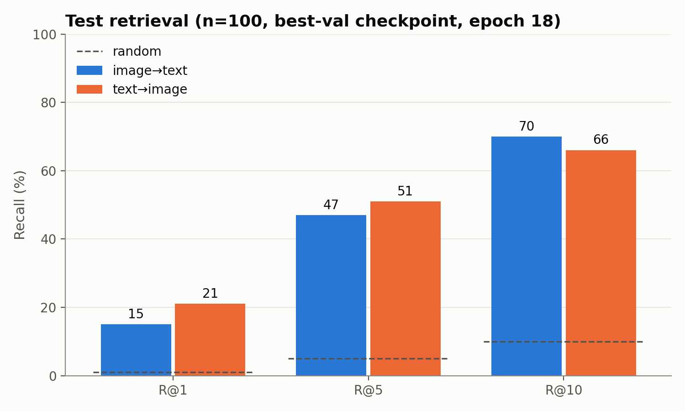
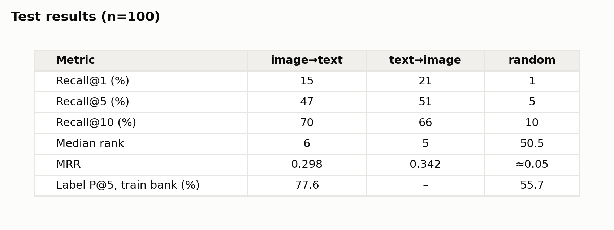
- **무엇:** best 모델(epoch 18)로 test 100건을 한 번만 평가한 최종 성적입니다. 막대 위의 점선이 random 기준값입니다.
- **결과:** image→text R@1 / R@5 / R@10 = 15 / 47 / 70, text→image = 21 / 51 / 66. median rank는 6 / 5등입니다.
  - val(R@5 54~58)보다 조금 낮지만 같은 수준입니다. val과 test 모두 100건 안팎이라 이 정도 차이는 표본 크기로 생기는 오차 범위입니다.
  - label P@5 77.6%는 random(55.7%)보다 22%p 높습니다. 다만 라벨 2(GBM)가 많아서 생기는 부분이 크니, 라벨별 값(위 "train bank 검색" 표)을 함께 봐야 합니다.

#### 기타 학습 상태 (`all/` 폴더)
- **`train__logit_scale`:** 학습 내내 **100으로 고정**돼 있었습니다.
  - CLIP 사전학습 값이 이미 상한(100)에 있어서, 코드의 `clamp(max=100)`에 걸려 더 이상 학습되지 않았습니다.
  - 사실상 temperature 0.01로 고정해서 학습한 셈입니다.
- **`train__grad_norm`:** gradient 크기는 0.24~84 사이였습니다.
  - clipping 기준이 1.0이라 대부분의 step에서 clipping이 걸렸습니다. 실제 update 크기는 학습률이 결정했습니다.
- **`epoch__peak_vram_gb`:** 13.6GB로 일정했습니다(24GB 제한 이내).
- **`epoch__time_sec`:** epoch당 31~51초였습니다. 같은 GPU를 쓰는 다른 작업의 부하에 따라 달라졌습니다.

## 유사도 분포 기반 adaptive K와 confidence score (`plot-dist.ipynb`)

RAG 단계에서 쓸 노블티인 **"유사도 분포를 보고 K를 고르고, 확신도 c로 프롬프트를 바꾼다"**를, 학습한 CLIP(`runs/clip_hardmut/best.pt`)으로 실제로 계산해 본 결과입니다.

```bash
# 서버에서 실행 (GPU 1, 약 35초)
cd ~/Workspace/rrg-clip && ~/.conda/envs/rrg-clip/bin/jupyter nbconvert --to notebook --execute --inplace plot-dist.ipynb
```
VS Code Remote 등에서 `rrg-clip` 커널을 골라 셀 단위로 실행해도 됩니다. 설정값 `K_MIN`, `K_MAX`, `FIXED_K`는 첫 코드 셀에 있습니다.
결과는 `runs/clip_hardmut/dist/`에 저장됩니다.

### 설정
- **쿼리 q:** MRI 이미지 임베딩만 사용
  - 현재 데이터의 human 입력에는 Age/Sex만 있고 brief findings가 없어서, 이미지와 텍스트를 합치는(fuse) 부분은 아직 없습니다.
- **소견서 DB:** train 811 case의 소견서 (텍스트 인코더 임베딩)
- **쿼리:** val 90건, test 100건
  - 쿼리의 정답 소견서는 DB에 없습니다. 실제로 새 환자가 들어왔을 때와 같은 조건입니다.

### K를 고르는 방법 (largest gap)
쿼리 하나마다 다음 순서로 계산합니다(`adaptive_k()` 함수).

1. 쿼리와 DB 소견서 811개의 cosine 유사도를 모두 구합니다.
2. 내림차순으로 정렬합니다: s(1) ≥ s(2) ≥ … ≥ s(811)
3. 이웃한 순위끼리 차이를 구합니다: Δi = s(i) − s(i+1)
4. **i = K_MIN … K_MAX(지금은 1~10) 범위에서 Δi가 가장 큰 i를 K\*로 정합니다.**
   - 유사도 곡선에서 가장 크게 "뚝 떨어지는 절벽"을 찾아, 그 절벽 위쪽 K\*개만 LLM에 넘긴다는 뜻입니다.
   - 절벽 위쪽은 "쿼리와 확실히 비슷한 그룹", 아래쪽은 "나머지"로 봅니다.
5. 확신도 c = Δ(K\*) / (σ(s) + ε)를 구합니다.
   - σ(s)는 811개 유사도 전체의 표준편차입니다.
   - 절벽의 높이를 쿼리 유사도의 전체 퍼짐으로 나눠, 쿼리마다 스케일이 달라도 비교할 수 있게 합니다.
6. c ≥ τ이면 Confident 프롬프트, c < τ이면 Uncertain 프롬프트를 씁니다.

```python
def adaptive_k(s_sorted, k_min=1, k_max=10, eps=1e-6):
    d = s_sorted[:-1] - s_sorted[1:]          # d[i-1] = Δ_i
    k_star = int(np.argmax(d[k_min - 1:k_max])) + k_min
    gap = d[k_star - 1]
    return k_star, gap, gap / (s_sorted.std() + eps)
```

**실제 예시 (test 쿼리)**

| | AA0189 (Case A, 뾰족) | AA0194 (Case B, 평평) |
|---|---|---|
| 정렬된 유사도 | **0.269**, 0.210, 0.200, 0.199, … | 0.225, 0.224, 0.223, 0.221, … |
| 가장 큰 Δ (1~10등 범위) | 1등과 2등 사이 0.059 | 3등과 4등 사이 0.002 |
| K\* | 1 | 3 |
| σ(s) | 0.067 | 0.076 |
| **c** | 0.059 / 0.067 = **0.87** | 0.002 / 0.076 = **0.03** |
| 해석 | 1등 하나가 확실히 비슷함 → Confident | 다 고만고만해 뚜렷한 후보가 없음 → Uncertain |

Case B는 절벽이 사실상 없습니다. 이럴 때 K\*는 1~10등 중 그나마 큰 틈에서 정해지므로 의미가 약하고, 이 사실은 c가 매우 작다는 것으로 드러납니다.

### 검색 품질을 어떻게 쟀나
정답 소견서가 DB에 없어서 "정답을 찾았나"로는 평가할 수 없습니다. 대신 다음 대리 지표를 씁니다.
- **IDH 일치율:** 검색된 top-K 소견서 중, 결론의 IDH 그룹이 쿼리와 같은 비율
  - IDH(isocitrate dehydrogenase)는 신경교종을 나누는 핵심 유전자 표지입니다. WHO 2021 분류 기준입니다.
  - **IDH-wildtype:** 교모세포종(glioblastoma). 고령에 많고 공격적이며 예후가 나쁩니다. 데이터에서는 label 2입니다.
  - **IDH-mutant:** 핍지교종(1p/19q codeletion 있음) 또는 IDH-mutant 성상세포종. 예후가 상대적으로 좋습니다. 데이터에서는 label 0, 1입니다.
  - 소견서 마지막 문장이 이 결론을 담고 있습니다. 검색 결과가 반대 계열이면 LLM이 진단을 잘못 쓰게 유도할 수 있으므로, 임상적으로 가장 중요한 범주가 맞는지를 보는 지표입니다.
- **label 일치율:** top-K 중 label(0/1/2)이 같은 비율
- **RepSim:** 쿼리의 실제 소견서와 검색된 소견서 사이의 텍스트 임베딩 cosine 평균. 문장 내용이 얼마나 비슷한지를 봅니다.

### 결과

| | val (90) | test (100) |
|---|---|---|
| c 범위 / 중앙값 | 0.07–0.66 / 0.21 | 0.03–0.87 / 0.21 |
| 평균 K\* | 3.0 | 2.6 |
| IDH 일치: top-K\* / 고정 top-5 | 93.8 / 92.4% | 83.4 / 82.4% |
| label 일치: top-K\* / 고정 top-5 | 81.3 / 80.2% | 77.0 / 77.6% |

c 크기로 쿼리를 3등분해 비교했습니다(val+test 190건).

| c 그룹 | 건수 | 평균 c | 평균 K\* | top-1 IDH 일치 | top-K\* IDH 일치 | 고정 top-5 IDH 일치 |
|---|---|---|---|---|---|---|
| low | 64 | 0.13 | 4.3 | 84.4% | 84.5% | 86.6% |
| mid | 62 | 0.22 | 2.5 | 83.9% | 86.6% | 82.6% |
| high | 64 | 0.44 | 1.5 | **93.8%** | **94.0%** | 92.2% |

K\* 분포 (190건): K\*=1이 82건, 2가 34건, 3이 23건, 4가 14건, 5~10이 37건입니다.

### 해석
- **c 분포는 오른쪽 꼬리가 깁니다.** 대부분 0.1~0.4에 있고, 일부 쿼리만 0.5 이상으로 뾰족합니다. Case A와 Case B가 실제로 나뉘므로 이중 프롬프트를 쓸 근거가 됩니다.
- **val과 test의 c 분포가 거의 같습니다.** τ를 validation에서 정해 test에 적용하는 방식이 성립합니다. 그림에는 val 중앙값 0.21을 τ 후보로 임시 표시했습니다.
- **c가 높으면 IDH 수준에서는 검색이 더 정확합니다.** 상위 1/3은 약 94%, 나머지는 약 84%입니다. 단 190건이라 통계 검정이 필요합니다.
- **K\*=1이 43%입니다.** 가장 큰 절벽이 1등 바로 뒤에서 나오는 경우가 많아, Confident 쿼리는 대개 소견서 1개만 넘기게 됩니다. K_MIN=2 같은 ablation이 필요합니다.
- **c와 소견서 내용 유사도(RepSim)는 거의 무관합니다** (Spearman ρ = −0.15). c와 가장 강하게 연관된 것은 top-1 유사도 s(1)입니다(ρ = +0.57). 지금 c는 "진단 범주가 맞는가"는 어느 정도 반영하지만, "문장 내용이 비슷한가"는 반영하지 못합니다.
- **σ(s)가 쿼리마다 거의 같습니다**(0.075 ± 0.006). 그래서 지금 c는 사실상 Δ를 상수로 나눈 값입니다. 학습 때 temperature가 100에 고정됐던 영향일 수 있습니다.
- **adaptive K와 고정 top-5의 평균 성능은 비슷합니다**(±1%p). 이 방법의 이득은 평균 검색 정확도보다, c로 쿼리를 나눠 프롬프트를 바꾸는 생성 단계에서 확인해야 합니다.

### 그래프

#### 유사도 곡선 예시: `dist/01_similarity_curves_example.png`
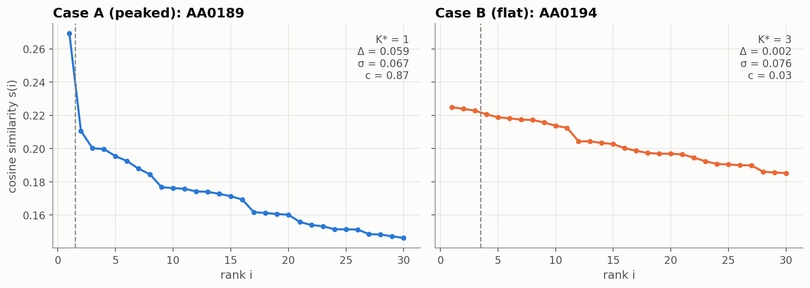
- 점선이 K\* 위치(절벽)입니다. 왼쪽 Case A는 1등 뒤에서 크게 떨어지고, 오른쪽 Case B는 평평하게 내려갑니다.

#### c 상위/하위 25% 쿼리의 곡선: `dist/02_similarity_curves_by_confidence.png`
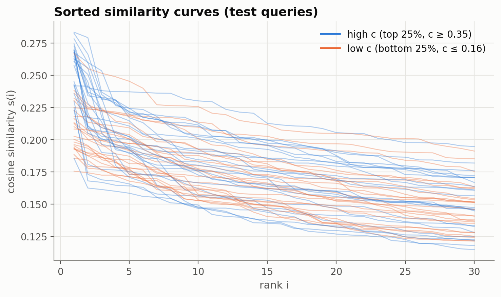
- c가 높은 쿼리(파랑)는 1~3등에서 급하게 꺾이고, c가 낮은 쿼리(주황)는 완만하게 내려갑니다.

#### c 분포: `dist/03_confidence_hist.png`
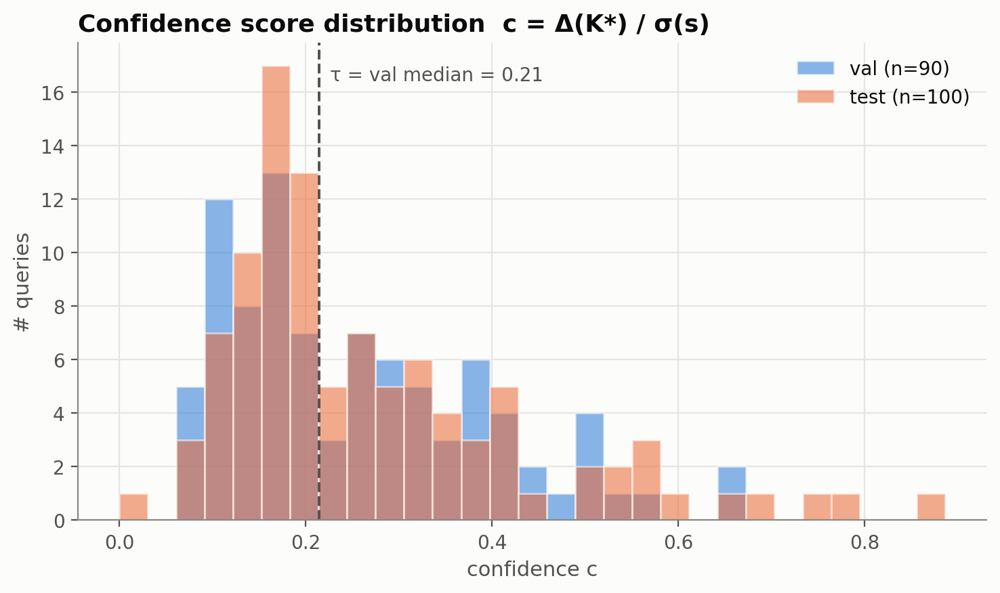
- val과 test 분포가 거의 겹칩니다. 점선은 τ 후보(val 중앙값 0.21)입니다.

#### K\* 분포: `dist/04_kstar_hist.png`
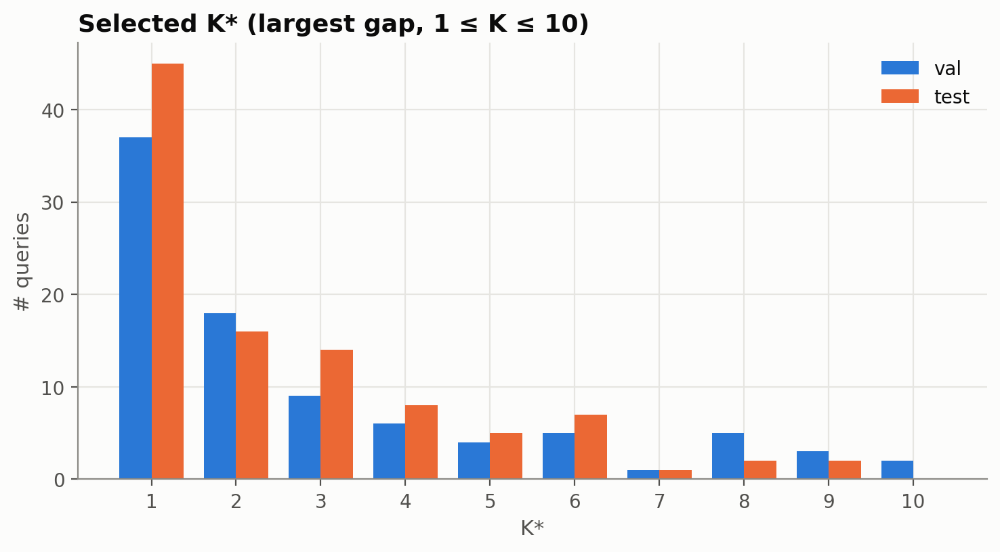
- K\*=1에 크게 몰려 있습니다.

#### c와 검색 품질: `dist/05_confidence_vs_quality.png`
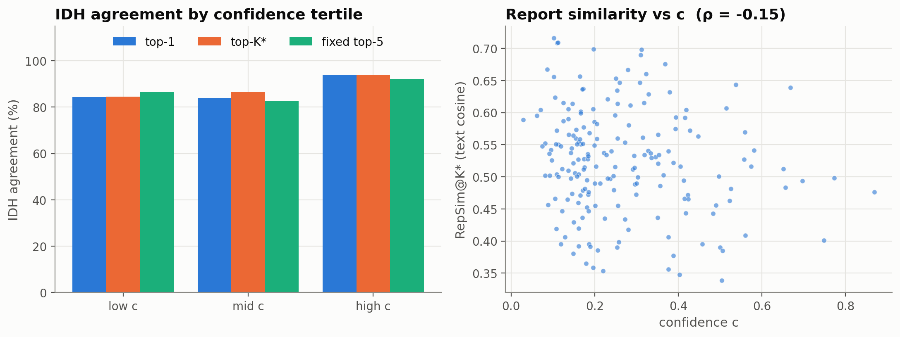
- 왼쪽: c 상위 1/3 그룹만 IDH 일치율이 약 94%로 높습니다.
- 오른쪽: c와 소견서 내용 유사도 사이에는 뚜렷한 관계가 없습니다.

### 저장 파일
- `dist/confidence_scores.csv`: 쿼리별 K\*, Δ, σ, c, s(1), IDH/label 일치율, RepSim
- `dist/confidence_tertile_summary.csv`: c 3등분 그룹별 요약
- `dist/ablation_kmin_*.csv`, `dist/06_ablation_kmin.png`: 아래 K_min ablation 결과
- `dist/split_*.csv`, `dist/07_split_roles.png`: 아래 역할 분리 결과

### Ablation: K_min = 1 vs 2 (노트북 7번 섹션)

> **한 줄 요약:** "최소 2개는 넘기자(K_min=2)"로 바꾸면 소견서는 평균 1.4개 더 넘어가지만 검색 정확도는 거의 그대로입니다. 대신 **c가 "믿을 만한 쿼리"를 가려내는 힘이 절반으로 줄어듭니다.**

#### 1) K_min이 뭔가요?
K\*를 찾을 때 **"몇 등 뒤의 틈부터 후보로 볼 것인가"**를 정하는 값입니다.
- **K_min=1:** 1등과 2등 사이 틈(Δ1)부터 봅니다. 가장 큰 틈이 Δ1이면 **소견서 1개만** 넘깁니다.
- **K_min=2:** Δ1은 무시하고 2등과 3등 사이 틈(Δ2)부터 봅니다. 그래서 **항상 최소 2개**를 넘깁니다.

비유하자면 시험 성적표에서 "확실히 잘한 학생 그룹"을 끊는 기준선을 찾는 것과 같습니다. K_min=1은 1등 혼자만 끊어도 되고, K_min=2는 적어도 2명은 그룹에 넣어야 한다는 규칙입니다.

#### 2) 왜 해 봤나요?
K_min=1에서는 쿼리의 **43%(190건 중 82건)가 K\*=1**이었습니다. 1등 바로 뒤에서 유사도가 크게 떨어지는 경우가 많기 때문입니다.
LLM에 소견서 1개만 주면, 그 1개가 틀렸을 때 그대로 따라 쓸 위험이 있습니다. 그래서 "최소 2개는 보여 주면 어떨까?"를 확인한 실험입니다.

#### 3) 쿼리 하나로 보는 차이 (test AA0189)
정렬된 유사도: **0.269**, 0.210, 0.200, 0.199, 0.195, … (1등만 혼자 높음)

| | K_min=1 | K_min=2 |
|---|---|---|
| 후보로 보는 틈 | Δ1 ~ Δ10 | Δ2 ~ Δ10 (Δ1 = 0.059 제외) |
| 가장 큰 틈 | Δ1 = 0.059 | Δ2 = 0.010 |
| K\* (넘기는 소견서 수) | 1 | 2 |
| c | **0.87** (전체에서 가장 높음) | **0.15** |
| τ (val 중앙값) | 0.21 | 0.16 |
| 프롬프트 | Confident | **Uncertain** |

DB에서 가장 확실하게 비슷한 소견서를 찾은 쿼리인데도, K_min=2에서는 "확신 없음"으로 분류됩니다. 1등이 혼자 튀어 있다는 가장 강한 신호(Δ1)를 계산에서 빼 버렸기 때문입니다.

반대로 AA0194처럼 처음부터 평평한 쿼리는 가장 큰 틈이 이미 3등 뒤에 있어서, 두 설정에서 K\*=3, c=0.03으로 같습니다.

#### 4) 전체 결과 (val 90 + test 100 = 190건)

| | K_min=1 | K_min=2 | 뜻 |
|---|---|---|---|
| K\*가 K_min과 같은 비율 | 43% | 28% | 최소 개수만 넘기는 쿼리 비율 |
| 평균 K\* | 2.8 | 4.2 | 평균 1.4개 더 넘김 |
| c 중앙값 (= τ) | 0.21 | 0.16 | c가 전반적으로 작아짐 |
| IDH 일치 @K\* (val / test) | 93.8 / 83.4% | 92.7 / 81.9% | 검색 정확도는 거의 같음 |
| label 일치 @K\* | 79.1% | 78.3% | 거의 같음 |
| RepSim@K\* | 0.524 | 0.527 | 거의 같음 |
| IDH 일치: Confident 쿼리 / Uncertain 쿼리 | **93.1 / 83.7%** | 89.3 / 84.6% | 두 그룹 차이가 **9.4%p → 4.7%p** |
| Spearman ρ(c, IDH 일치) | +0.15 | +0.03 | c와 정확도의 관계가 거의 사라짐 |

- K\*가 바뀐 쿼리는 82건으로, K_min=1에서 K\*=1이던 쿼리 전부입니다. 나머지 108건은 K\*와 c가 그대로입니다.
- **"IDH 일치: Confident / Uncertain"이 가장 중요한 줄입니다.** 노블티는 "c가 높으면 검색을 믿고, 낮으면 덜 믿는다"입니다. 그러려면 c가 높은 쿼리가 실제로 더 정확해야 합니다.
  - K_min=1에서는 Confident 쿼리가 9.4%p 더 정확했습니다.
  - K_min=2에서는 그 차이가 4.7%p로 줄었습니다.
  - 즉 c가 맞는 쿼리와 틀릴 수 있는 쿼리를 가려내는 힘이 약해졌습니다.

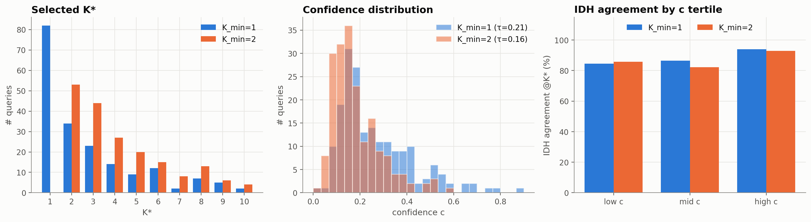

그래프 읽는 법은 다음과 같습니다.
- **왼쪽 (K\* 분포):** 파랑(K_min=1)은 K\*=1에 82건이 몰려 있습니다. 주황(K_min=2)은 그 쿼리들이 대부분 K\*=2~3으로 옮겨갔습니다.
- **가운데 (c 분포):** 주황은 왼쪽(작은 값)으로 몰려 있고, 파랑에 있던 0.6 이상의 "아주 확신하는" 쿼리가 사라졌습니다.
- **오른쪽 (c 3등분 그룹별 IDH 일치율):** 두 설정 모두 high c 그룹이 가장 높습니다. 다만 K_min=2는 low와 mid의 순서가 뒤집혀서, c가 높을수록 정확하다는 경향이 덜 깔끔합니다.

#### 5) 결론과 다음 단계
- **K_min=2의 장점:** 항상 2개 이상을 넘기므로 소견서 1개에 의존하는 위험이 줄고, 검색 정확도 손해는 약 1%p로 작습니다.
- **K_min=2의 단점:** c가 가장 정보가 많은 신호(1등이 혼자 튀어 있는가)를 잃습니다. 그래서 Confident/Uncertain 분기의 근거가 약해집니다.
- **설계 제안:** 두 역할을 나누는 방식입니다. 실험 결과는 바로 아래 "역할 분리" 섹션에 있습니다.
  - c(어떤 프롬프트를 쓸지)는 **K_min=1**로 계산합니다.
  - K(몇 개를 넘길지)는 **K_min=2**로 정합니다.

### 역할 분리: c는 K_min=1, K는 K_min=2 (노트북 8번 섹션)

> **한 줄 요약:** 확신도 c는 K_min=1로, 넘길 소견서 수 K는 K_min=2로 따로 정하면, **항상 2개 이상 넘기면서도 c의 구분력을 대부분(9.4%p 중 8.2%p) 지킬 수 있습니다.**

#### 1) 무엇을 바꿨나
지금까지는 틈 찾기를 **한 번** 해서 K\*와 c를 같이 정했습니다. 역할 분리는 같은 유사도 곡선에서 틈 찾기를 **두 번** 합니다.

```
s 정렬 ─┬─ ① 1~10등에서 가장 큰 틈 (K_min=1) → c → 프롬프트 선택 (c ≥ τ → Confident)
        └─ ② 2~10등에서 가장 큰 틈 (K_min=2) → K → LLM에 넘길 소견서 개수
```

- ① c를 계산할 때는 "1등이 혼자 튀어 있다"는 신호(Δ1)를 그대로 씁니다. 그래서 확신도가 정확하게 유지됩니다.
- ② 넘길 개수는 1등 뒤에서 끊지 못하게 해서, 항상 2개 이상을 넘깁니다.
- τ는 c를 K_min=1로 계산하므로 K_min=1과 같은 0.21(val 중앙값)입니다.

```python
_, _, c = adaptive_k(s, k_min=1)   # ① 확신도
K, _, _ = adaptive_k(s, k_min=2)   # ② 넘길 개수
prompt = CONFIDENT if c >= tau else UNCERTAIN
```

예시 (test AA0189, 1등만 혼자 높은 쿼리):

| | K_min=1 | K_min=2 | **역할 분리** |
|---|---|---|---|
| 넘기는 소견서 | 1개 | 2개 | **2개** |
| c | 0.87 | 0.15 | **0.87** |
| 프롬프트 | Confident | Uncertain | **Confident** |

#### 2) 결과 (val+test 190건)

| | K_min=1 | K_min=2 | **역할 분리** |
|---|---|---|---|
| 평균 K (넘기는 소견서 수) | 2.8 | 4.2 | 4.2 |
| 소견서 1개만 넘기는 쿼리 | 43% | 0% | **0%** |
| Confident로 분류된 쿼리 | 49% | 52% | 49% |
| IDH 일치 @K (전체) | 88.4% | 87.0% | 87.0% |
| label 일치 @K | 79.1% | 78.3% | 78.3% |
| IDH 일치: Confident 쿼리 | 93.1% | 89.3% | 91.2% |
| IDH 일치: Uncertain 쿼리 | 83.7% | 84.6% | 83.0% |
| **Confident − Uncertain 차이** | **+9.4%p** | +4.7%p | **+8.2%p** |

val과 test를 따로 보면 다음과 같습니다(Confident − Uncertain 차이).

| | K_min=1 | K_min=2 | 역할 분리 |
|---|---|---|---|
| val (90) | +5.0%p | +1.6%p | +6.1%p |
| test (100) | +13.1%p | +8.2%p | +10.0%p |

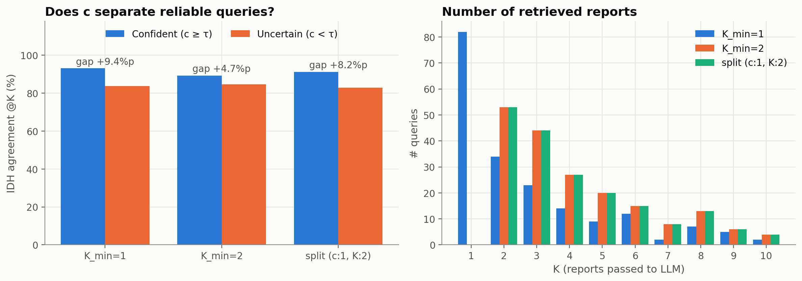

그래프 읽는 법은 다음과 같습니다.
- **왼쪽:** 설정마다 Confident 쿼리(파랑)와 Uncertain 쿼리(주황)의 IDH 일치율입니다. 막대 사이 차이(gap)가 클수록 c가 믿을 만한 쿼리를 잘 가려낸다는 뜻입니다.
- **오른쪽:** 쿼리마다 몇 개의 소견서를 넘기는지 보여 줍니다. 역할 분리(초록)는 K_min=2(주황)와 똑같습니다. K는 K_min=2로 정하기 때문입니다.

#### 3) 해석
- **넘기는 소견서 수와 검색 정확도는 K_min=2와 같습니다.** K를 K_min=2로 정하므로 당연한 결과입니다. 소견서 1개만 넘기는 쿼리가 없어집니다.
- **c의 구분력은 K_min=1에 가깝게 회복됩니다.** Confident와 Uncertain의 차이는 다음과 같습니다.
  - K_min=2: +4.7%p
  - 역할 분리: +8.2%p
  - K_min=1: +9.4%p
- **K_min=1보다 차이가 조금 줄어든 이유:** K가 늘어난 82건 중 55건이 Confident 쿼리입니다. 이 쿼리들은 원래 확실한 1등 1개만 넘겼는데, 이제 덜 비슷한 2등 이후도 함께 넘깁니다. 그래서 IDH 일치율이 91.5%에서 88.4%로 조금 내려갔습니다.
  - 이 손해는 Confident 프롬프트에서 **"1번 소견서를 주 근거로, 나머지는 보조로"**처럼 순위와 유사도 점수를 함께 알려 주면 생성 단계에서 줄일 수 있습니다.
- **주의할 점:** val에서는 차이가 +1.6~6.1%p로 작고, test에서는 +8.2~13.1%p로 큽니다. 표본이 작아서(90/100건) 흔들림이 큽니다. 논문 주장을 하려면 bootstrap 신뢰구간이나 교차검증으로 확인해야 합니다.

#### 4) 결론
- 검색 단계만 보면 **역할 분리가 두 설정의 절충안으로 가장 합리적입니다.** K_min=2처럼 항상 2개 이상을 넘기고, c의 구분력은 K_min=1에 가깝게 지킵니다.
- 실제로 더 좋은 소견서가 나오는지는 LLM 생성 단계에서 세 설정을 비교해 확인해야 합니다. 비교할 지표는 BLEU/ROUGE, IDH 결론 정확도, hallucination 비율입니다.

## 다음에 해 볼 것
- **좌우 학습 보강:** 이미지를 좌우 반전하면서 소견서의 left↔right 단어를 맞바꾸는 증강. 좌우 일치율이 무작위 수준이라 가장 먼저 해 볼 만합니다.
- **과적합 완화:** epoch 15 전후로 줄이기, 증강 강화, 학습하는 블록 수 줄이기, val을 여러 seed로 반복 평가
- **temperature 학습:** logit_scale이 상한 100에 고정돼 있었습니다. 초기값을 낮추거나(예: 1/0.07 ≈ 14.3) 상한을 조정해 실제로 학습되게 하기
- **mutant 성능 높이기:** `--fusion separate`(T1까지 4개 모달리티), 라벨/IDH 보조 분류 loss 추가
- `--num_slices`(8/16/24) 비교
- `--unfreeze_vision_layers -1`로 전체 fine-tuning (과적합 주의)
- 의료 특화 CLIP으로 교체: BiomedCLIP 등. `open_clip` 설치가 필요하고 코드를 조금 고쳐야 합니다.
- 소견서끼리 내용이 비슷해서 생기는 false negative 완화: 라벨이나 소견서 유사도로 soft target 만들기
- 텍스트 생성 지표 추가: top-1 소견서와 정답 소견서 사이 BLEU/ROUGE/BERTScore
